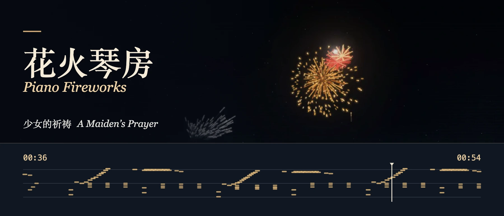
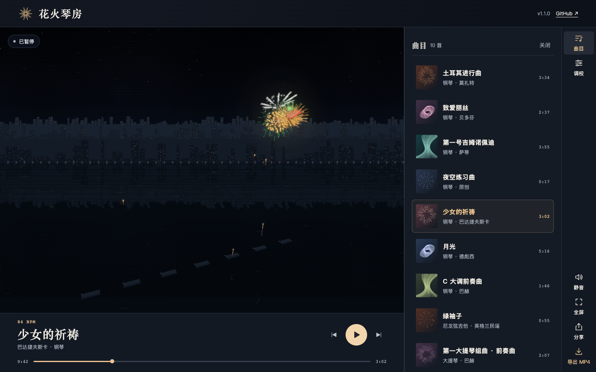

# Piano Fireworks

Fifty-five instrumental pieces, each with its own fireworks display. Start with *A Maiden’s Prayer* and watch a shell lift from the riverbank in time to open on a piano note.

**[Enter the concert hall](https://piano-fireworks.xiaosang.cc/)**　·　[Watch the 22-second excerpt with sound](https://piano-fireworks.xiaosang.cc/media/maidens-prayer.mp4)　·　[简体中文](README.md)

[](https://piano-fireworks.xiaosang.cc/media/maidens-prayer.mp4)

Try *Senbonzakura on Ice* for a different kind of score. Each detected onset in the ice performance launches a shell. Choose a close-up camera or scatter the launch positions across the frame.

## Hear the same chord two ways

Open the playlist at the right end of the transport to choose a piece.

Open the tuning panel (调校) and loop six seconds (循环试听 6 秒). Set preset A to one burst per note (每个音符) and B to group simultaneous notes (同拍合并). Switch between them as the phrase repeats. A chord that fills the sky with several shells now lands as a single burst.

The hall opens in classic firework colors. Choose peony or willow shells, turn up the wind to see the trails drift, or watch from ground level. Your browser remembers both presets, which one was active, your last piece and your mute setting.

## Take a seat for another piece

| Piece | Instrument | What to watch for |
| --- | --- | --- |
| Bądarzewska, *A Maiden’s Prayer* | Piano | The opening fan widens through the phrase |
| Debussy, *Clair de lune* | Piano | Trails linger in the space between phrases |
| *Greensleeves* | Nylon-string guitar | In the call-and-response section, low and high notes light opposite banks |
| Joplin, *The Entertainer* | Marimba | The bursts trace the offbeat accents of the rag |

The ten Chinese selections include a flute and đàn tranh arrangement of the Yangzhou *Jasmine Flower* and a chamber round on *Defend the Yellow River* from Xian Xinghai’s cantata.

<details>
<summary>See the player and all fifty-five pieces</summary>



[Score credits and recording notes for all fifty-five pieces (Chinese)](music/SOURCES.md)

</details>

Go fullscreen to watch the performance. Use 分享 to copy an invitation or save a QR card. 导出 MP4 saves the full concert as a 720p video with its soundtrack, opening title and closing card.

## Listen offline

Download the [source repository](https://github.com/holynova/piano-fireworks) and open `index.html`. To use a local server, run the command below from the project directory, then visit `http://localhost:8080`.

```sh
python3 -m http.server 8080
```

[Player guide (Chinese)](docs/player-guide.md) · [Rebuild the recordings (Chinese)](music/SOURCES.md#重建) · To deploy to the configured Cloudflare Worker, run `npm ci` followed by `npm run deploy`.

<a href="https://piano-fireworks.xiaosang.cc/"></a>
