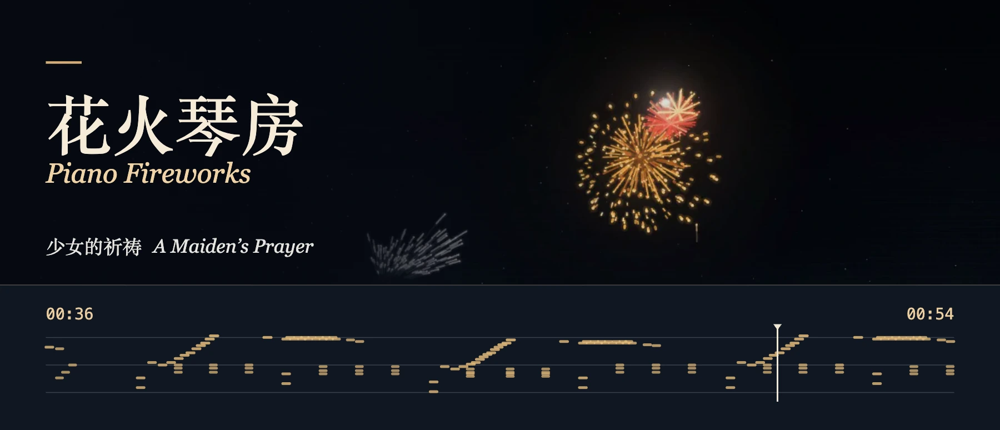

# 花火琴房

十首器乐曲的网页烟花演出。点开《少女的祈祷》，看烟花先从岸边升起，在琴键落下的那一刻绽开。

**[进入观演厅](https://piano-fireworks.xiaosang.cc/)**　·　[看 22 秒有声演示](https://piano-fireworks.xiaosang.cc/media/maidens-prayer.mp4)　·　[English](README.en.md)

[](https://piano-fireworks.xiaosang.cc/media/maidens-prayer.mp4)

## 听一遍，再换一种放法

在右侧打开「调校」，点「循环试听 6 秒」。把方案 A 设为「每个音符」，方案 B 设为「同拍合并」。切换 A/B，你会看到同一个和弦从几朵同时绽放的烟花，变成一次集中的爆点。

默认用经典焰色。在「花型」里点选牡丹或垂柳，调大风速看余辉偏向一侧，或把机位切到地面仰望。浏览器会记住两组方案、当前方案、曲目和静音设置。

## 换一首听

| 曲目 | 乐器 | 可以留意的地方 |
| --- | --- | --- |
| 巴达捷夫斯卡《少女的祈祷》 | 钢琴 | 开场的扇面随乐句逐渐张开 |
| 德彪西《月光》 | 钢琴 | 在舒缓的乐句之间，看烟花的余辉落下 |
| 《绿袖子》 | 尼龙弦吉他 | 进入「两岸对答」段，高低音在两岸呼应 |
| 乔普林《演艺人》 | 马林巴 | 听切分节奏，看爆点落在什么位置 |

<details>
<summary>查看播放器和完整曲目单</summary>


[十首曲目的乐谱来源与音轨制作](music/SOURCES.md)

</details>

全屏可以只看演出。「分享」可复制介绍和网址，也可生成二维码卡片。「导出 MP4」会把整首演出保存为带音轨、片头和片尾的 720p 视频。

## 离线观演

下载[项目源码](https://github.com/holynova/piano-fireworks)，打开 `index.html` 即可。也可以在项目目录运行以下命令，访问 `http://localhost:8080`。

```sh
python3 -m http.server 8080
```

[播放器手册](docs/player-guide.md) · [重建曲库](music/SOURCES.md#重建) · 部署到已配置的 Cloudflare Worker 可运行 `npm ci` 和 `npm run deploy`。

<a href="https://piano-fireworks.xiaosang.cc/"></a>
