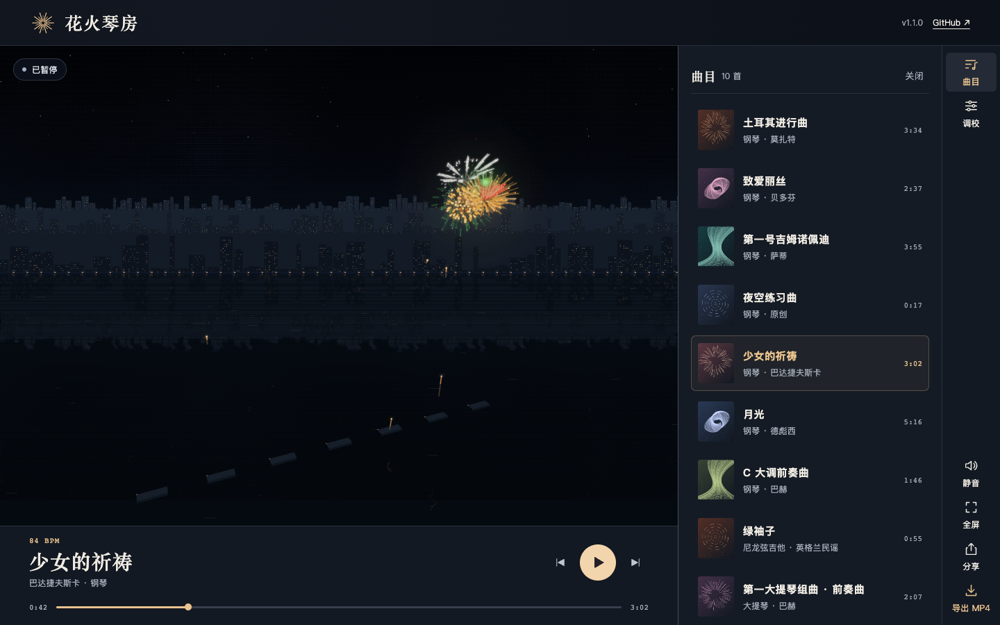

# 花火琴房

[进入观演厅](https://piano-fireworks.xiaosang.cc/) · [English](README.en.md) · [GitHub](https://github.com/holynova/piano-fireworks)

巴达捷夫斯卡《少女的祈祷》的琴音响起时，岸边升起的烟花刚好绽开。这是一座按乐谱编排的网页观演厅，收录了十首钢琴、吉他、大提琴和马林巴曲目。

[](https://piano-fireworks.xiaosang.cc/media/maidens-prayer.mp4)

[▶ 看《少女的祈祷》演示 · 22 秒，有声](https://piano-fireworks.xiaosang.cc/media/maidens-prayer.mp4)

## 试一段乐句

1. 点播放，听默认的《少女的祈祷》。在「曲目」里也能切到德彪西《月光》或吉他版《绿袖子》。
2. 打开「调校」，循环试听同一段六秒。用 A、B 两组方案比较「每个音符」与「同拍合并」，看和弦绽成几朵烟花。
3. 从默认的「经典焰色」开始，换花型、调风速或编排巡镜。两组方案、上次选的曲目和静音设置都保存在当前浏览器。

全屏可只看演出。右侧「分享」可复制介绍和网址，也能生成二维码卡片。「导出 MP4」会生成带原音轨、曲名和项目二维码的 720p 视频。

## 本地运行

下载仓库并打开 `index.html` 即可离线播放。也可在项目目录启动静态服务，然后访问 `http://localhost:8080`。

```sh
python3 -m http.server 8080
```

部署到已配置的 Cloudflare Worker 时运行 `npm ci` 和 `npm run deploy`。[播放器手册](docs/player-guide.md) · [乐谱来源与音轨重建](music/SOURCES.md)

<a href="https://piano-fireworks.xiaosang.cc/"></a>
